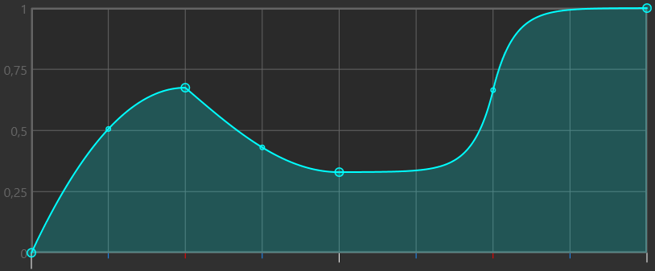

Sliderator позволяет создавать слайдеры или стримы, скорость которых меняется на протяжении движения.

Чтобы начать работу, импортируйте слайдер с помощью элементов управления в левом верхнем углу и редактируйте график правой кнопкой мыши.

:::caution Не подходит для ранкинга

Слайдеры, созданные с помощью Sliderator, не подходят для ранкинга. Подробнее см. [этот пост на Reddit](https://www.reddit.com/r/osugame/comments/xnmcuq/acceldecel_sliders_made_with_mapping_tool_is_now/?utm_source=share&utm_medium=web2x&context=3).

:::

## Импорт слайдеров {#importing}

Перед началом работы с Sliderator импортируйте один или несколько слайдеров с помощью кнопки **Импортировать слайдеры** в левом верхнем углу. Есть три способа импортировать слайдеры:

- **Выбранные**: импортирует слайдеры, выбранные в редакторе osu!.
- **С закладками**: импортирует слайдеры выбранной карты, на которых стоят закладки.
- **По времени**: импортирует слайдеры выбранной карты, на которые указывает временной код, введённый в соседнее поле. Формат временного кода должен совпадать с форматом, который получается при копировании объектов из редактора в текстовое поле. Например: `00:56:823 (1,2,1,2) -`.

Если импортировано несколько слайдеров, переключайтесь между ними кнопками влево и вправо. Если нажать эти кнопки с зажатой клавишей Shift, Sliderator сначала быстро обработает текущий слайдер, а затем переключится на следующий.

При выборе слайдера автоматически задаются значения **Длительность бита**, **BPM** и **Глобальная SV**.

## График {#graph}

График является основной частью Sliderator. Здесь задаётся перемещение шарика по слайдеру во времени.

Ось X показывает **время** на протяжении всего слайдера. Его длительность задаётся параметром **Длительность бита**. Делитель привязки доли для линий по оси X можно изменить ползунком под графиком.

Для оси Y доступны два режима. Переключайте их зелёной кнопкой под графиком:

- **X**: режим положения. Ось Y показывает положение вдоль слайдера, поэтому можно задать, где именно должен находиться шарик в любой момент времени.
- **V**: режим скорости. Ось Y показывает множитель скорости слайдера. Его значения находятся в пределах положительного и отрицательного **предела SV**.

### Редактирование графика {#editing-graph}

Для редактирования графика используются контрольные точки и интерполяция.

Чтобы добавить контрольную точку, **щёлкните правой кнопкой мыши** в любом месте графика. Щёлкните правой кнопкой по точке, чтобы открыть контекстное меню: в нём можно удалить точку или изменить способ интерполяции. Удерживайте Shift и щёлкните правой кнопкой по точке, чтобы удалить её сразу. Перетаскивайте точки левой кнопкой мыши. Чтобы перемещать область просмотра и менять её масштаб, перетаскивайте фон левой кнопкой или прокручивайте колёсико мыши.

В середине каждого интерполированного участка есть небольшая контрольная точка. Перетаскивайте её вверх или вниз, чтобы изменить форму интерполяции. Щёлкните по ней правой кнопкой мыши, чтобы сбросить её положение.

Также можно использовать горячие клавиши при перемещении контрольных точек:

- **Shift** ограничивает движение горизонтальной плоскостью.
- **Ctrl** ограничивает движение вертикальной плоскостью.
- **Alt** отключает привязку.

### Другие параметры графика {#graph-controls}

В этом разделе описаны другие настройки графика.

- **Длительность бита**: длительность слайдера в долях. Также влияет на ширину графика.
- **BPM**: темп, в котором работает слайдер. Он должен совпадать с BPM в месте экспорта слайдера.
- **Глобальная SV**: множитель скорости слайдеров карты. Он должен совпадать с множителем выбранной карты.
- **Предел SV**: максимальная SV на графике. В режиме скорости также влияет на высоту графика. По умолчанию задано значение 10, что соответствует максимальной SV для унаследованных тайминговых точек.
- **Подогнать завершение** масштабирует все контрольные точки по вертикали так, чтобы шарик доходил по слайдеру до заданного процента завершения.
- **Сбросить график** возвращает график к исходному виду.
- **Показывать красные опорные точки** отображает положения красных опорных точек слайдера горизонтальными красными линиями в режиме положения.
- **Показывать опорные точки графика** отображает контрольные точки графика в предпросмотре слайдера.
- **Ожидаемое количество сегментов** показывает примерное количество опорных точек слайдера для текущих настроек. Значения меньше 10000 не должны вызывать заметных задержек в игре.

## Параметры экспорта {#export-options}

При запуске Sliderator экспортирует обработанный слайдер в выбранную карту и указанное время. Его можно добавить к существующим объектам карты или включить **Перезаписать**, чтобы заменить ими объекты в этом месте.

Если включить **Вместо этого экспортировать как стрим**, Sliderator создаст не слайдер, а последовательность кругов, повторяющую скорость и длительность слайдера. Количество кругов на долю определяется делителем привязки доли графика.

Можно вручную задать **Новую SV** для обработанного слайдера. Она должна быть близка к максимальной скорости на графике. Обычно автоматическое значение достаточно, но иногда его можно немного уменьшить, чтобы сократить количество опорных точек без заметного ухудшения качества слайдера.

Параметр **Минимальная длина опухоли** позволяет значительно сократить количество опорных точек в итоговом слайдере. Sliderator замедляет шарик с помощью невидимых опухолей; при увеличении минимальной длины программа создаёт более крупные опухоли, и их требуется меньше. Недостаток в том, что движение шарика по более крупным опухолям становится менее плавным.

Параметр **Передать SV в BPM** заставляет Sliderator использовать BPM для задания новой SV слайдера. Это снимает ограничение унаследованных тайминговых точек в 10x SV. Кроме того, становится доступен параметр **Удалить тики слайдера**: он удаляет тики с помощью унаследованной тайминговой точки со значением SV `NaN`.
