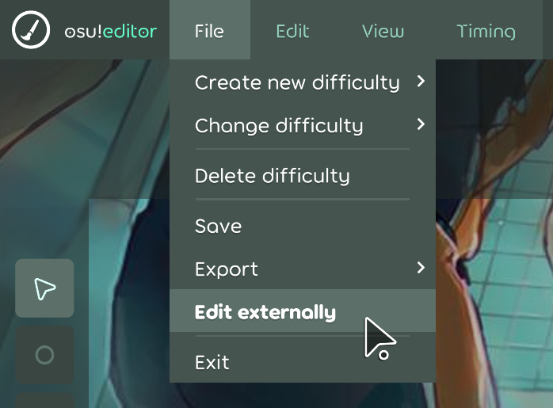

Процесс редактирования карт в [osu! lazer](https://github.com/ppy/osu) отличается от osu! stable. Mapping Tools умеет редактировать файлы карт обоих клиентов. В lazer используйте функцию внешнего редактирования и помните, что у некоторых функций есть ограничения.

## Как использовать Mapping Tools в osu! lazer

В редакторе osu! lazer выберите **Файл > Редактировать во внешнем редакторе**. Будет создана временная папка со всеми файлами набора карт, который вы сейчас редактируете. Mapping Tools автоматически найдёт эту папку и выберет её в качестве текущей карты. После редактирования нажмите **Завершить редактирование и импортировать изменения**, и osu! lazer загрузит изменения.

## Совместимость

В osu! lazer работают не все функции Mapping Tools. Ниже перечислены совместимость функций и ограничения.

Любые функции, которым нужен Editor Reader, не работают в osu! lazer. Если вы собираетесь использовать только osu! lazer, рекомендуется отключить Editor Reader в **Настройках**.

### Общее
- :x: команда **Открыть текущую карту** не работает
- :x: команда **Текущее время редактора** не работает
- :x: выбор **Выбранные игровые объекты** не работает
- :white_check_mark: функция **Создать резервную копию** работает
- :white_check_mark: функция **Загрузить резервную копию** работает
- :white_check_mark: **Траектории слайдеров** с несколькими типами сегментов полностью поддерживаются

### Инструменты
- :x: **Geometry Dashboard** не работает: инструмент зависит от Editor Reader.
- :white_check_mark: **Hitsound Copier** работает.
- :large_orange_diamond: **Hitsound Studio** работает, но ссылки на импортированные сэмплы и карты перестанут работать после удаления временной папки.
- :white_check_mark: **Pattern Gallery** работает.
- :white_check_mark: **Property Transformer** работает.
- :white_check_mark: **Sliderator** работает, но редактор lazer сильно тормозит.
- :white_check_mark: **Tumour Generator 2** работает.
- :large_orange_diamond: **Auto-fail Detector** работает, но в lazer нет автофейла.
- :white_check_mark: **Combo Colour Studio** работает.
- :white_check_mark: **Hitsound Preview Helper** работает.
- :white_check_mark: **Map Cleaner** работает.
- :white_check_mark: **Mapset Merger** работает.
- :white_check_mark: **Metadata Manager** работает.
- :white_check_mark: **Rhythm Guide** работает.
- :white_check_mark: **Slider Completionator** работает.
- :white_check_mark: **Slider Merger** работает.
- :large_orange_diamond: **Slider Picturator** работает, но слайдер-картинка не отображается в lazer.
- :white_check_mark: **Timing Copier** работает.
- :white_check_mark: **Timing Helper** работает.

## Обратите внимание на совместимость с будущими версиями lazer

osu! lazer активно разрабатывается, поэтому его клиент и формат файлов могут измениться и нарушить работу Mapping Tools.
Если у вас возникнет проблема с Mapping Tools в lazer, которой нет в этом списке, сообщите о ней через команду **О программе > Сообщить о проблеме**.
